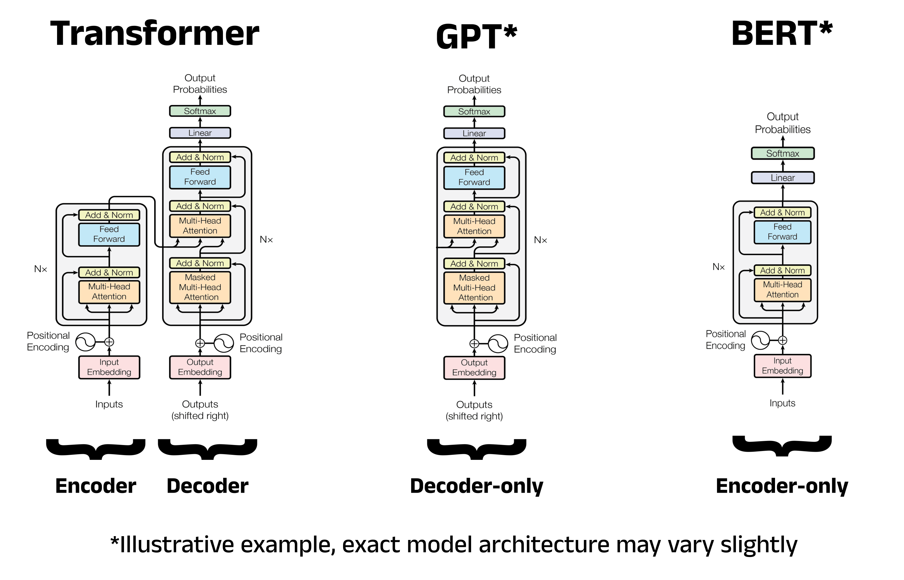

# Transformers From Scratch

Transformers are a class of neural network built around self-attention. This repo implements three kinds from scratch in PyTorch (encoder-decoder, decoder-only and encoder-only) to see how they differ in practice.

## Approach

I extended Andrej Karpathy's approach from [char-rnn](https://github.com/karpathy/char-rnn) and his "Let's build GPT" lecture, and implemented three types of Transformers from scratch:
- **Encoder-decoder** (BART-style)
- **Decoder-only** (GPT-style)
- **Encoder-only** (BERT-style)

## Workflow

* **Datasets:** Tiny Shakespeare (character-level baseline) and TinyStories (subword tokens)
* **Tokenization:** BPE (Byte Pair Encoding), trained with Hugging Face `tokenizers` on the TinyStories training split
* **Data split:** train/validation splits, with `get_batch` sampling random windows from each split for every model
* **Models:** `Head` / `MultiHead` / `FeedForward` / block structure with pre-LayerNorm and residual connections
* **Training and evaluation:** AdamW training loop and the `estimate_loss` pattern

## Architecture

## Components

| Component | What it does |
|---|---|
| `Head` | One scaled dot-product attention head, with optional causal mask and cross-attention |
| `MultiHead` | Runs several heads in parallel, then projects and applies dropout |
| `FeedForward` | Linear (4x) -> ReLU -> Linear -> dropout |
| `EncoderBlock` | Bidirectional self-attention + feed-forward |
| `DecoderBlock` | Causal self-attention + cross-attention + feed-forward |
| `BART` | Encoder + decoder stacks, embeddings, LM head, `generate` |
| `GPT` | Decoder-only causal stack |
| `BERT` | Bidirectional stack trained to recover randomly masked tokens |

## Results

### Experiment 1: Tiny Shakespeare (character-level)

90/10 split, `n_embd=192`, 4 heads, dropout 0.2, AdamW at 3e-4, 5000 steps. Loss is cross-entropy per character (an untrained model starts at about 4.32, close to ln 65 ≈ 4.17).

| Model | Parameters | Train loss | Val loss |
|---|---|---|---|
| BART-style encoder-decoder (predict next 128 chars from previous 128) | 3.16M | 1.490 | 1.686 |
| GPT-style decoder-only | 3.38M | 1.486 | 1.672 |
| BERT-style encoder-only | TBD | TBD | TBD |

The generated text has Shakespeare-like structure but mostly pseudo-words, which is expected at this scale. The BART and GPT results are within 0.02 of each other from a single seed each, so I don't claim a difference between them. BERT will be reported as masked-token accuracy, since its objective differs and its loss isn't comparable.

### Experiment 2: TinyStories (BPE, 3,000 tokens)

Same architecture settings. Loss is cross-entropy per token, so it is not comparable with Experiment 1.

| Model | Parameters | Train loss | Val loss |
|---|---|---|---|
| BART-style encoder-decoder | 4.29 M | 2.087 | 2.188 |
| GPT-style decoder-only | 3.84 M | 2.084 | 2.194 |
| BERT-style encoder-only | 3.84 M | 1.842 | 1.910 |

All three models are being retrained from scratch with identical settings for this table.

## Next Steps

1. **KV cache in `generate`**: cache keys and values so each new token no longer recomputes attention over the whole sequence, then measure the speedup.
2. **Complete the TinyStories comparison**: retrain all three models from scratch with a warmup and cosine learning-rate schedule, report bits per character, and run several seeds.
3. **BART denoising objective**: train the encoder-decoder to reconstruct corrupted text instead of only continuing it.
