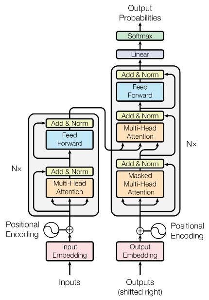
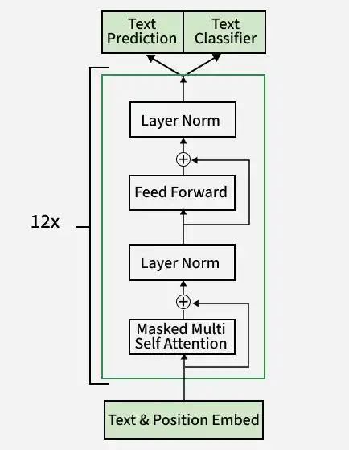

encoder-decoder

# BERT, GPT and BART from Scratch

Small character-level BERT-, GPT- and BART-style Transformers implemented from scratch in PyTorch on Tiny Shakespeare, to understand how encoder-only, decoder-only and encoder-decoder architectures differ in practice.

## How I Used Andrej Karpathy's Work

I started from Andrej Karpathy's [char-rnn](https://github.com/karpathy/char-rnn) dataset and his "Let's build GPT" lecture, and reused his overall approach: character-level tokenization, a `Head` / `MultiHead` / `FeedForward` / block structure with pre-LayerNorm and residual connections, the `get_batch` and `estimate_loss` pattern, and the AdamW training loop.

On top of that foundation I extended the code myself:
- Added a switch for **causal vs. bidirectional** attention, giving the GPT (decoder-only) and BERT (encoder-only) variants.
- Added **cross-attention** (keys and values from the encoder output) to build a decoder block.
- Combined an encoder stack and a decoder stack into a **BART-style encoder-decoder**, with its own batch function (source window, shifted target window).
- Adapted the sampling loop for the encoder-decoder (temperature and top-k); this part was written with AI assistance.

## Architecture

## Components

| Component | What it does |
|---|---|
| `Head` | One scaled dot-product attention head, with optional causal mask and cross-attention |
| `MultiHead` | Runs several heads in parallel, then projects and applies dropout |
| `FeedForward` | Linear (4x) -> ReLU -> Linear -> dropout |
| `EncoderBlock` | Bidirectional self-attention + feed-forward |
| `DecoderBlock` | Causal self-attention + cross-attention + feed-forward |
| `BART` | Encoder + decoder stacks, embeddings, LM head, `generate` |
| `GPT` | Decoder-only causal stack |

## Results

Tiny Shakespeare, 90/10 split, `n_embd=192`, 4 heads, 3 layers, dropout 0.2, AdamW at 3e-4, 5000 steps.

| Model | Parameters | Train loss | Val loss |
|---|---|---|---|
| BART-style encoder-decoder (predict next 128 chars from previous 128) | 3.16M | 1.490 | 1.686 |
| GPT-style decoder-only | 3.38M  | 1.486 | 1.672 |
| BERT-style encoder-only | TBD | TBD | TBD |

Loss is cross-entropy per character, starting from about 4.32 (ln 65 ≈ 4.17). The generated text has Shakespeare-like structure but mostly pseudo-words, which is expected at this scale. GPT and BERT results are still pending, and their losses won't be directly comparable because the training objectives differ.

## Next Steps

1. **KV cache in `generate`**: cache keys and values so each new token no longer recomputes attention over the whole sequence, then measure the speedup.
2. **Change the dataset**: move from Tiny Shakespeare to a larger, more useful dataset with a task that benefits from an encoder (for example summarization).
3. **Proper tokenization**: replace character-level tokens with a subword tokenizer (BPE).
